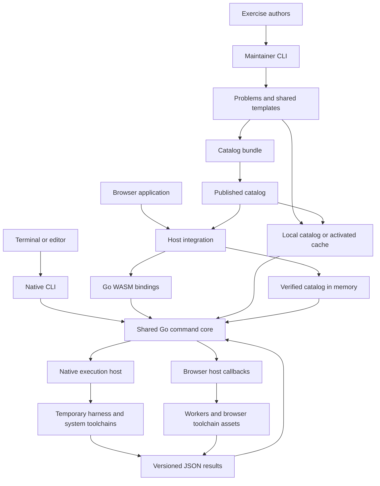
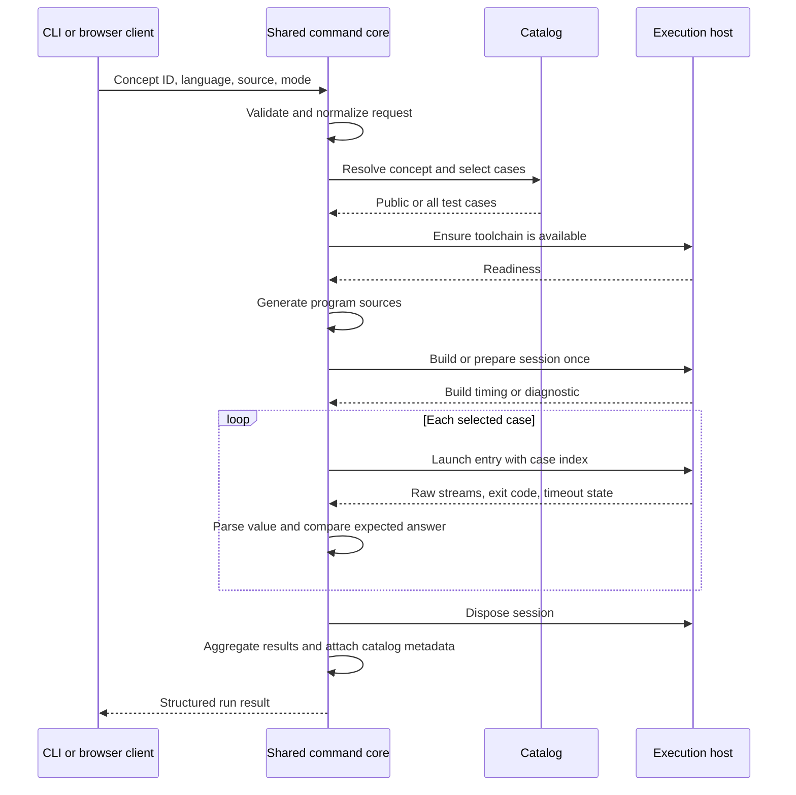

# Architecture and browser integration

[Project README](../README.md#documentation)

Polyglot Rosetta uses a shared Go command core for the native CLI and browser integrations. Each host supplies catalog access, toolchain readiness, and solution execution.

## System design

The native and browser execution paths are alternatives selected by the adapter. The engine and catalog do not include language compilers: native runs use tools on `PATH`, while a browser host supplies its own runtime assets. The browser application, workers, and runtime delivery are integration responsibilities; a browser SDK is not shipped in this repository.

## Evaluation flow

The shared Go evaluator generates the program sources, requests one host build, and launches each selected case separately. The native host writes sources to a temporary workspace and uses installed compilers and child processes. The browser host uses the same sources with browser compilers and isolated workers. Both return raw output for Go to parse and grade. Native submissions execute with the user's access; this is trusted local practice, not a sandbox.

The language harness calls `Solve` and reports the returned value and solution-call time. Answer comparison happens in Go for both native and WASM runs, after each host execution returns. Rust receives generated `JsonValue` expressions for its input, so the harness does not need a custom JSON parser. Rust and Zig preserve their existing convention of returning plain text for string expectations and JSON text for other expectations.

The browser host implements readiness, build, run-one-case, and disposal callbacks and provides worker management and deadlines. The Go core handles request validation, case selection, program generation, execution ordering, output parsing, answer comparison, aggregation, and result validation in both environments. It delegates only environment-specific operations to the host.

## Integration boundaries

Editors send the current buffer through `prosetta run --stdin --format=json` and preserve the process exit status. `prosetta catalog` returns the local content root for reading exercises and index metadata.

Browser hosts load `prosetta.wasm` with the matching `wasm_exec.js`, verify downloaded catalog assets before activation, and bind their readiness and execution callbacks. Runtime-specific cross-origin isolation requirements and language runtime delivery belong to the browser host deployment. See the [browser implementation guide](browser-integration.md) for the contract and activation sequence.

The JavaScript entry point is `ProsettaCore`. Call `help()` to discover methods or `help("bind")` for host callback requirements. The host contract requires `refreshCache`, `ensureAvailable`, `buildProgram`, `runCase`, and `disposeProgram`; `clearCache` is needed when clearing readiness. `help()` describes payload fields and reports `host_api_version` separately from command result schemas. `probe` and `run` return Promises, while `version`, `catalog`, and `help` return synchronously.

JSON requests and results are defined in [`internal/api`](../internal/api/). Clients should validate `schema_version` (currently `1`) and use full concept IDs. See the [development guide](development.md#local-setup-and-builds) for build commands.

## Source map

- [`cmd/prosetta`](../cmd/prosetta/): public native entry point.
- [`cmd/generate`](../cmd/generate/): maintainer entry point for scaffolding, discovery, and packaging.
- [`cmd/wasm`](../cmd/wasm/): browser exports registered on `ProsettaCore`.
- [`internal/commands`](../internal/commands/): command services and native/WASM adapters.
- [`internal/api`](../internal/api/): transport-neutral request and result types.
- [`internal/catalog`](../internal/catalog/): metadata, IDs, content enrichment, bundles, and synchronization.
- [`internal/execution`](../internal/execution/): shared harness generation, evaluation orchestration, comparison, and native host operations.
- [`internal/toolchain`](../internal/toolchain/): native tool discovery and readiness cache.
- [`internal/wasm`](../internal/wasm/): JavaScript conversion, promises, discovery, and host binding.

The Go module uses the local name `polyglot-rosetta`, and most packages are internal. Integrate through the CLI or WASM surface; this repository does not advertise a supported public Go library API.

## Reading the native execution code

Start with [`evaluator.go`](../internal/execution/evaluator.go): it prepares sources, requests a host build, runs each selected case, compares the result, and disposes the session. The remaining files have narrow responsibilities:

- [`program.go`](../internal/execution/program.go) declares each language's optional build command, per-case run command, and supporting files.
- [`harness.go`](../internal/execution/harness.go) renders the matching [language template](../internal/execution/harnesses/) into an in-memory program shared by native and browser hosts.
- [`host.go`](../internal/execution/host.go) defines the environment boundary and validates host responses; [`native.go`](../internal/execution/native.go) implements workspace, compiler, and process operations on the local machine.
- [`harness_input.go`](../internal/execution/harness_input.go) constructs Rust input expressions and byte literals from catalog data.
- [`build.go`](../internal/execution/build.go) executes the optional compiler command once and records its duration, including failed attempts. Python skips this stage.
- [`result_protocol.go`](../internal/execution/result_protocol.go) reads the private process result record. Output bytes are hex encoded so multiline text cannot break record framing.
- [`comparison.go`](../internal/execution/comparison.go) compares returned values using the shared JSON rules.
- [`runner.go`](../internal/execution/runner.go) owns child-process deadlines and captured output limits.

The public command selects cases and checks toolchain readiness through its host adapter. `internal/run` supplies native catalog content and readiness; it does not maintain a separate evaluation path. Browser hosts return build metadata and raw case output under the [staged execution contract](../internal/api/execution/host.go); the shared evaluator owns comparison and aggregation.

Native build duration measures the compiler process for the combined solution and harness. One generated program contains the selected inputs; the same build is launched in a new process for each case. Compilation failure stops evaluation before any case runs. Every new `run` builds in a new workspace; Prosetta does not cache compiled solutions across runs, although compilers can use their own caches.
