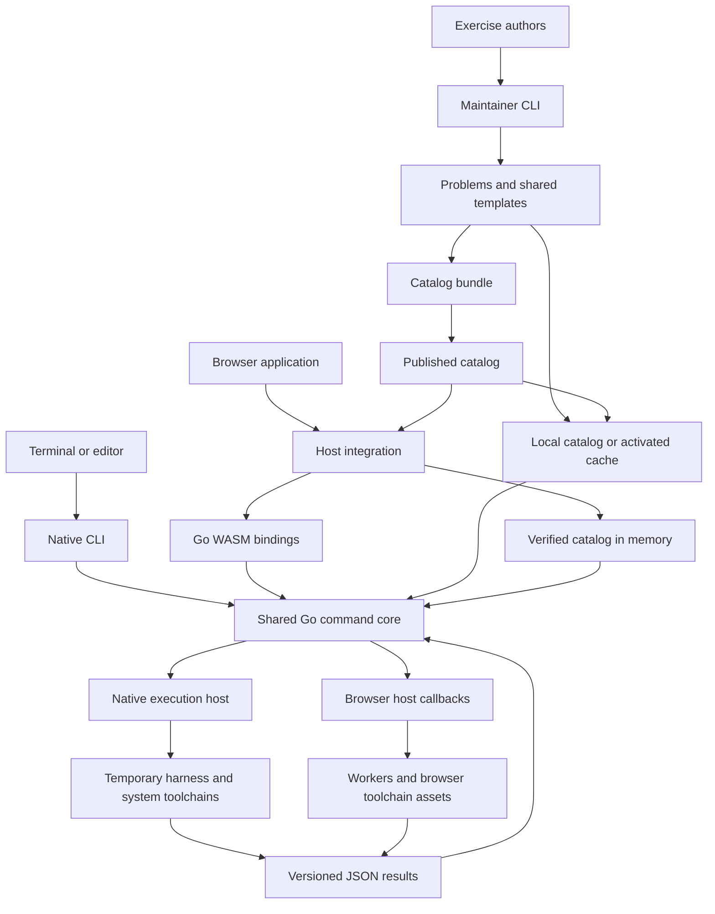
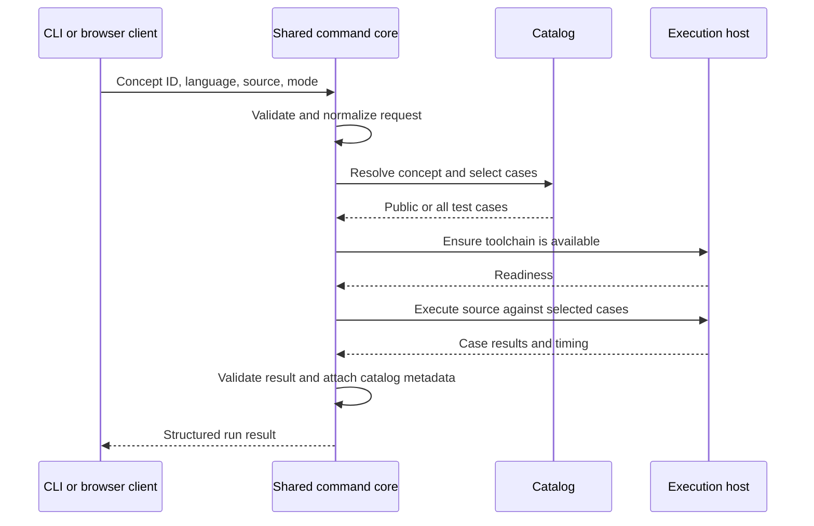

# Architecture and browser integration

[Project README](../README.md#documentation)

Polyglot Rosetta uses a shared Go command core for the native CLI and browser integrations. Each host supplies catalog access, toolchain readiness, and solution execution.

## System design

The native and browser execution paths are alternatives selected by the adapter. The engine and catalog do not include language compilers: native runs use tools on `PATH`, while a browser host supplies its own runtime assets. The browser application, workers, and runtime delivery are integration responsibilities; a browser SDK is not shipped in this repository.

## Evaluation flow

The native host generates a harness in a temporary workspace, builds when needed, and runs each case in a separate process. It bounds execution time and captured output, then cleans up the workspace. Submissions execute with the user's access; this is trusted local practice, not a sandbox.

The browser host must implement readiness and execution callbacks and provide worker management and deadlines. The Go core handles request validation, case selection, host invocation, and result validation in both environments. It delegates compilation and case execution to the host.

## Integration boundaries

Editors send the current buffer through `prosetta run --stdin --format=json` and preserve the process exit status. `prosetta catalog` returns the local content root for reading exercises and index metadata.

Browser hosts load `prosetta.wasm` with the matching `wasm_exec.js`, verify downloaded catalog assets before activation, and bind their readiness and execution callbacks. Runtime-specific cross-origin isolation requirements and language runtime delivery belong to the browser host deployment. See the [browser implementation guide](browser-integration.md) for the contract and activation sequence.

The JavaScript entry point is `ProsettaCore`. Call `help()` to discover methods or `help("bind")` for host callback requirements. Hosts bind `refreshCache`, `ensureAvailable`, and `execute`; `clearCache` is needed when clearing readiness. `probe` and `run` return Promises, while `version`, `catalog`, and `help` return synchronously.

JSON requests and results are defined in [`internal/api`](../internal/api/). Clients should validate `schema_version` (currently `1`) and use full concept IDs. See the [development guide](development.md#local-setup-and-builds) for build commands.

## Source map

- [`cmd/prosetta`](../cmd/prosetta/): public native entry point.
- [`cmd/generate`](../cmd/generate/): maintainer entry point for scaffolding, discovery, and packaging.
- [`cmd/wasm`](../cmd/wasm/): browser exports registered on `ProsettaCore`.
- [`internal/commands`](../internal/commands/): command services and native/WASM adapters.
- [`internal/api`](../internal/api/): transport-neutral request and result types.
- [`internal/catalog`](../internal/catalog/): metadata, IDs, content enrichment, bundles, and synchronization.
- [`internal/execution`](../internal/execution/): native harness generation and process execution.
- [`internal/toolchain`](../internal/toolchain/): native tool discovery and readiness cache.
- [`internal/wasm`](../internal/wasm/): JavaScript conversion, promises, discovery, and host binding.

The Go module uses the local name `polyglot-rosetta`, and most packages are internal. Integrate through the CLI or WASM surface; this repository does not advertise a supported public Go library API.
